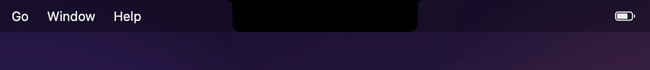
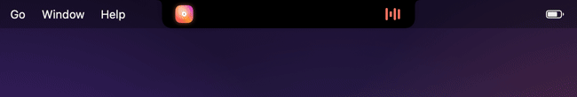

<div align="center">


# Çentik

**Your MacBook notch, finally useful.**

Music, live system stats, an AI chat, a clipboard history, a file shelf, meeting countdowns<br>
and coding-agent alerts, living right where the notch is. Free, open source, no account, no tracking.

[](https://github.com/YusufEmreYazici/Centik/releases/latest)
[](Package.swift)
[](LICENSE)
[](https://github.com/YusufEmreYazici/Centik/actions/workflows/ci.yml)
[](https://github.com/YusufEmreYazici/Centik/releases)

[**Download for Mac**](https://github.com/YusufEmreYazici/Centik/releases/latest) · [Features](#features) · [Install](#install) · [Privacy](#privacy) · [Türkçe](README.tr.md)

<br>


</div>

<br>

> [!NOTE]
> The interface is in Turkish for now (*çentik* means "notch"). English is next on the [roadmap](#roadmap); the GIFs show the app exactly as it is today.

## Features

<table>
<tr>
<td width="50%" valign="top">

### 🎵 Music that lives in the notch
Spotify and Apple Music with artwork, scrubbing, shuffle and an animated equalizer in the artwork's color. Skip a track and the cover slides; a short peek shows what's playing next.

</td>
<td width="50%"></td>
</tr>
<tr>
<td></td>
<td valign="top">

### 📊 Live system stats
CPU, memory, GPU and network with 60-second graphs, per-core load, memory pressure, disk and the busiest apps, and an app list you can quit from. Pin any two metrics to the sides of the notch. Nothing is measured while it isn't on screen.

</td>
</tr>
<tr>
<td valign="top">

### ✨ Ask AI from the notch
Answers stream in as they're written. Bring your own account: an installed **Claude Code** or **Gemini CLI** (no key needed, Gemini's sign-in is free), a **Claude** or **Gemini API key** kept in your Keychain, or a fully local **Ollama**. Chat only: it can't read your files or run commands.

</td>
<td></td>
</tr>
<tr>
<td></td>
<td valign="top">

### 🔊 Volume, brightness, battery
Clean indicators slide out of the notch when you change the volume or brightness, plug in a charger or run low on battery. Network drops and returns are shown too, with short blips filtered out.

</td>
</tr>
<tr>
<td valign="top">

### 🔔 Alerts that matter
Claude Code waiting for approval or Codex finishing a turn, meetings about to start with a one-click **Join** for Zoom, Meet, Teams, Webex, FaceTime and Whereby, plus new screenshots and finished downloads.

</td>
<td></td>
</tr>
<tr>
<td></td>
<td valign="top">

### 🎨 Five themes, real motion
Night, Aurora, Glass, Neon and Minimal. The accent follows the album art or your own color. Springy hover, blur-to-sharp transitions and a sliding tab highlight, with style, speed and size all adjustable.

</td>
</tr>
</table>

### And everything else

| | |
|---|---|
| 📋 **Clipboard history** | Text, links, code, colors, images and files, with the source app, filters, a rich preview and pinning. Password-manager items are never stored. |
| 🗂️ **Shelf** | Drop files on the notch to park them; drag them out, AirDrop them or open them later. |
| 📸 **Captures** | New screenshots, screen recordings and finished downloads pop up with a preview. |
| 🗓️ **Calendar & meetings** | Today's events at a glance and a countdown before each meeting. |
| ⏱️ **Timer** | Presets, pause and +1 min, with a countdown ring in the notch. |
| 📝 **Notes** | Quick notes and to-dos, saved on disk. |
| 🪞 **Mirror** | A front-camera preview; the camera only runs while it's open and nothing is recorded. |
| ⛅ **Weather** | Current conditions for a city you pick, from Open-Meteo, with no location permission. |
| ☕ **Keep awake** | Stop the Mac from sleeping for a set time. |
| ⌨️ **Everywhere** | ⌃⌥N to open from any app. Hides in full-screen. Works on Macs without a notch too. Tabs can be hidden and reordered. |

## Install

1. Download **Centik.dmg** from the [latest release](https://github.com/YusufEmreYazici/Centik/releases/latest) and drag **Çentik** to Applications.
2. The app isn't notarized by Apple yet, so macOS blocks the first launch. Open it once, then go to **System Settings → Privacy & Security** and click **Open Anyway**. Or run:
   ```sh
   xattr -dr com.apple.quarantine /Applications/Çentik.app
   ```
3. Hover over the notch, or press **⌃⌥N**.

Requires macOS 14 Sonoma or later, on Apple Silicon or Intel.

## Privacy

Çentik runs entirely on your Mac. No account, no analytics, no crash reporting, no ads.

| What | Where it goes |
|---|---|
| Clipboard history, notes, shelf | Stays on your Mac (`~/Library/Application Support/Centik`) |
| Weather | Only the city's coordinates, to [Open-Meteo](https://open-meteo.com) |
| AI chat | Only to the provider **you** connect, with the date, time and weather as context |
| API keys | Your macOS Keychain, sent only to that provider |

**Permissions** are asked only when a feature needs them: Automation for Spotify/Music, Calendar, Camera for the mirror, and Desktop/Downloads for captures. No Accessibility, Screen Recording or Full Disk Access. The app is built with the hardened runtime, so other processes can't borrow these permissions.

## Build from source

```sh
git clone https://github.com/YusufEmreYazici/Centik.git
cd Centik
./build.sh --install     # builds dist/Çentik.app and copies it to /Applications
```

Xcode or the Command Line Tools are enough. `build.sh` signs with a local certificate it creates in `.signing/` (git-ignored), so macOS keeps your permissions between builds. Set `CENTIK_SIGN_ID=-` for an ad-hoc signature.

<details>
<summary><b>Developer tools</b></summary>

```sh
swift build
.build/debug/Centik --snapshot /tmp/snap    # every island state as PNGs
tools/make-demo-gifs.sh                     # re-record the GIFs in this README
```

Other apps and scripts can control the island with distributed notifications: `com.emre.centik.open` (object: a tab name such as `home` or `system`), `com.emre.centik.close` and `com.emre.centik.settings`.

Any tool can raise an alert through the hook script:

```sh
"$HOME/Library/Application Support/Centik/centik-hook.sh" mytool notification '{"message":"Build finished"}'
```

</details>

## Roadmap

- [ ] English interface
- [ ] Notarized releases and a Homebrew cask
- [ ] Browser media (YouTube and others)
- [ ] More widgets, such as focus stats and quick shortcuts

Ideas and votes are welcome in [Discussions](https://github.com/YusufEmreYazici/Centik/discussions).

## Known limits

- Media playing in a browser isn't shown yet. Since macOS 15.4, apps can't read the system's Now Playing data, so Çentik talks to Spotify and Apple Music directly through their AppleScript interface.
- The system's own volume and brightness indicators still appear alongside Çentik's.
- Brightness uses the private `DisplayServices` framework; on displays it doesn't support, brightness features turn themselves off.

## Contributing

Bug reports, ideas and pull requests are all welcome. See [CONTRIBUTING.md](CONTRIBUTING.md). For security issues, see [SECURITY.md](SECURITY.md).

If Çentik makes your notch better, a ⭐ helps others find it.

<div align="center">
<br>

[](https://star-history.com/#YusufEmreYazici/Centik&Date)

<sub>MIT License · Made with SwiftUI</sub>

</div>
