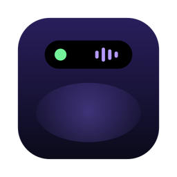
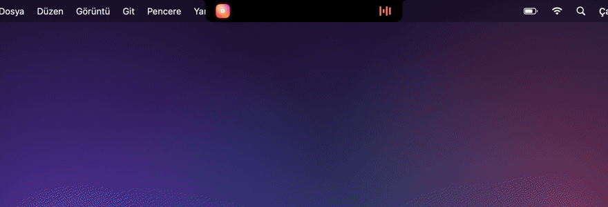
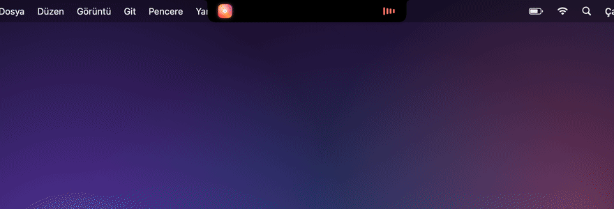
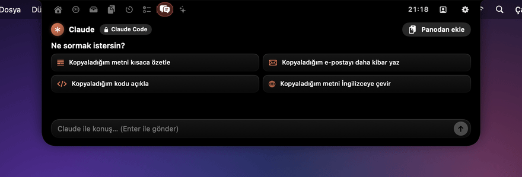
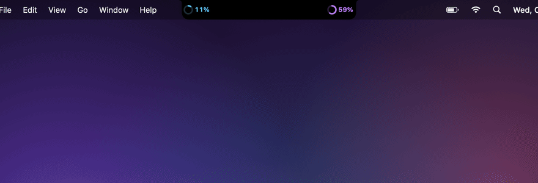
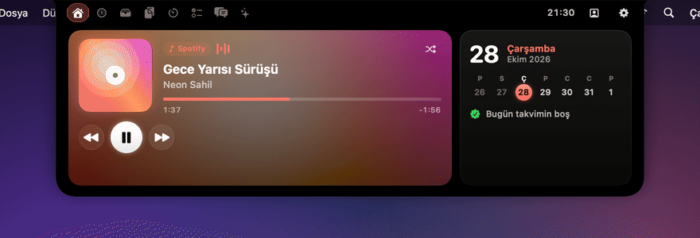

<div align="center">



# Çentik

**MacBook çentiğin sonunda işe yarıyor.**

Müzik, canlı sistem verileri, yapay zekâ sohbeti, pano geçmişi, dosya rafı, toplantı geri sayımı<br>
ve kodlama ajanı uyarıları, hepsi çentiğin olduğu yerde. Ücretsiz, açık kaynak, hesap yok, takip yok.

[](https://github.com/YusufEmreYazici/Centik/releases/latest)
[](LICENSE)
[](https://github.com/YusufEmreYazici/Centik/releases)

[**Mac için indir**](https://github.com/YusufEmreYazici/Centik/releases/latest) · [Özellikler](#özellikler) · [Kurulum](#kurulum) · [Gizlilik](#gizlilik) · [English](README.md)

<br>



</div>

## Özellikler

| | |
|---|---|
| 🎵 **Müzik** | Spotify ve Apple Music: kapak, sarma, karıştırma ve kapak renginde ekolayzır. Şarkı değişince kapak kayar, kısa bir önizleme çıkar. |
| 📊 **Sistem** | CPU, bellek, GPU ve ağ için 60 saniyelik grafikler, çekirdek yükü, bellek baskısı, disk, en çok kaynak kullanan uygulamalar ve oradan kapatma. İstersen iki göstergeyi çentiğin yanlarına sabitle. |
| ✨ **Yapay zekâ sohbeti** | Yanıt canlı akar. Kendi hesabını bağla: kurulu Claude Code ya da Gemini CLI (anahtar gerekmez, Gemini girişi ücretsiz), Anahtar Zinciri'nde saklanan Claude veya Gemini API anahtarı ya da tamamen yerel Ollama. Yalnızca sohbet: dosyalarına erişilmez, komut çalıştırılmaz. |
| 🔊 **Ses, parlaklık, pil** | Ses ya da parlaklık değişince, şarj takılınca veya pil azalınca çentikten şık göstergeler çıkar. İnternet kopunca ve gelince haber verir. |
| 🔔 **Uyarılar** | Claude Code onay beklerken ya da Codex işini bitirince haber verir. Toplantı yaklaşınca Zoom, Meet, Teams, Webex, FaceTime ve Whereby için tek tıkla **Katıl** düğmesi çıkar. Yeni ekran görüntüleri ve biten indirmeler de çentikte görünür. |
| 🎨 **Temalar** | Gece, Aurora, Cam, Neon ve Sade. Vurgu rengi kapaktan ya da seçtiğin renkten gelir. Hareket stili, hız ve boyut ayarlanabilir. |
| 📋 **Pano** | Metin, bağlantı, kod, renk, görsel ve dosya; kaynağı, filtreler, zengin önizleme ve sabitleme. Şifre yöneticisi öğeleri asla saklanmaz. |
| 🗂️ **Raf** | Dosyaları çentiğe bırak, sonra sürükle, AirDrop ile gönder ya da aç. |
| 🗓️ **Takvim** | Bugünün etkinlikleri ve toplantı geri sayımı. |
| ⏱️ **Zamanlayıcı, 📝 Notlar, 🪞 Ayna, ⛅ Hava, ☕ Uyanık tut** | Hepsi bir hareket uzağında. |
| ⌨️ **Her yerde** | Her uygulamadan ⌃⌥N. Tam ekranda gizlenir, çentiksiz Mac'lerde de çalışır. Sekmeler gizlenip sıralanabilir. |

<div align="center">
 
 
</div>

## Kurulum

1. [Son sürümden](https://github.com/YusufEmreYazici/Centik/releases/latest) **Centik.dmg** dosyasını indir ve **Çentik**'i Uygulamalar klasörüne sürükle.
2. Uygulama henüz Apple tarafından onaylanmadığı (notarize edilmediği) için macOS ilk açılışı engeller. Bir kez aç, sonra **Sistem Ayarları → Gizlilik ve Güvenlik**'te **Yine de Aç**'a tıkla. Ya da terminalde:
   ```sh
   xattr -dr com.apple.quarantine /Applications/Çentik.app
   ```
3. İmleci çentiğin üzerine getir ya da **⌃⌥N**'ye bas.

macOS 14 Sonoma ve sonrası; Apple Silicon ve Intel.

## Gizlilik

Çentik tamamen Mac'inde çalışır. Hesap, analiz, çökme raporu ve reklam yok.

| Ne | Nereye gider |
|---|---|
| Pano geçmişi, notlar, raf | Mac'inde kalır (`~/Library/Application Support/Centik`) |
| Hava durumu | Yalnızca şehrin koordinatları, [Open-Meteo](https://open-meteo.com)'ya |
| Yapay zekâ sohbeti | Yalnızca **senin** bağladığın sağlayıcıya; bağlam olarak tarih, saat ve hava |
| API anahtarları | macOS Anahtar Zinciri; yalnızca o sağlayıcıya gönderilir |

İzinler yalnızca bir özellik gerektirdiğinde istenir: Spotify/Müzik için Otomasyon, Takvim, ayna için Kamera, yakalama için Masaüstü/İndirilenler. Erişilebilirlik, Ekran Kaydı ya da Tam Disk Erişimi gerekmez. Uygulama güçlendirilmiş çalışma ortamıyla (hardened runtime) imzalanır; başka süreçler bu izinleri ödünç alamaz.

## Kaynaktan derleme

```sh
git clone https://github.com/YusufEmreYazici/Centik.git
cd Centik
./build.sh --install
```

Ayrıntılar, geliştirici araçları ve yol haritası için [İngilizce README](README.md)'ye bak.

## Katkı

Hata bildirimleri, fikirler ve pull request'ler memnuniyetle karşılanır: [CONTRIBUTING.md](CONTRIBUTING.md). Güvenlik sorunları için: [SECURITY.md](SECURITY.md).

Çentik işine yaradıysa bir ⭐ başkalarının da bulmasına yardım eder.
